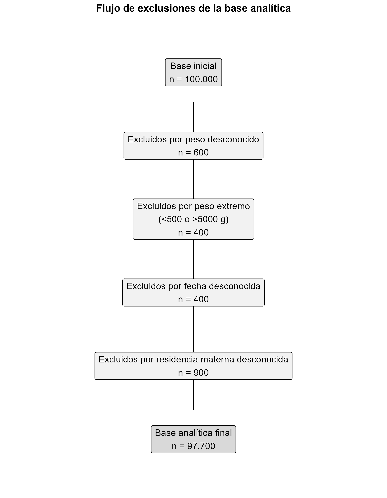

```{r}
#| label: setup
#| include: false

library(dplyr)
library(ggplot2)

base_original <- readRDS(
  "01_datos/nacimientos_guatemala.rds"
)

base <- readRDS(
  "01_datos/nacimientos_analisis.rds"
)

n_inicial <- nrow(base_original)
n_analitica <- nrow(base)
n_excluidos <- n_inicial - n_analitica

prevalencia_global <- 100 * mean(
  base$low_birth_weight
)

peso_medio <- mean(
  base$birth_weight_g
)

peso_mediano <- median(
  base$birth_weight_g
)

pct_missing_edad <- 100 * mean(
  is.na(base$maternal_age)
)

pct_missing_educacion <- 100 * mean(
  is.na(base$maternal_education)
)

pct_missing_indigena <- 100 * mean(
  is.na(base$maternal_indigenous_status)
)

pct_missing_marital <- 100 * mean(
  is.na(base$maternal_marital_status)
)

resumir_lbw <- function(datos, variable) {

  datos |>
    group_by({{ variable }}) |>
    summarise(
      n = n(),
      casos = sum(low_birth_weight == 1),
      prevalencia = casos / n,
      .groups = "drop"
    ) |>
    mutate(
      z = 1.96,
      centro = (
        prevalencia + z^2 / (2 * n)
      ) / (
        1 + z^2 / n
      ),
      margen = (
        z /
          (1 + z^2 / n)
      ) *
        sqrt(
          prevalencia * (1 - prevalencia) / n +
            z^2 / (4 * n^2)
        ),
      li95 = pmax(0, centro - margen),
      ls95 = pmin(1, centro + margen),
      across(
        c(prevalencia, li95, ls95),
        ~ .x * 100
      )
    ) |>
    select(
      -z,
      -centro,
      -margen
    )
}

tema_grafico <- theme_minimal(base_size = 12) +
  theme(
    plot.title = element_text(face = "bold"),
    plot.subtitle = element_text(colour = "grey30"),
    panel.grid.minor = element_blank(),
    plot.background = element_rect(
      fill = "white",
      colour = NA
    ),
    panel.background = element_rect(
      fill = "white",
      colour = NA
    )
  )
```

::: {.callout-note icon="false"}
## Sobre los datos

Este informe utiliza **registros generados artificialmente con fines docentes y de reproducibilidad**. Ninguna observación corresponde a una persona real y los resultados no deben interpretarse como estimaciones oficiales de Guatemala.
:::

## Contexto

El bajo peso al nacer es un indicador relevante de salud maternoinfantil. En este proyecto se exploran patrones temporales, estacionales y territoriales del peso al nacer y del bajo peso al nacer en Guatemala entre 2009 y 2024.

La base inicial contiene **`r format(n_inicial, big.mark = ".")` nacimientos ficticios** generados mediante un script reproducible con semilla fija. Después de aplicar los criterios definidos de calidad y elegibilidad, la muestra analítica contiene **`r format(n_analitica, big.mark = ".")` registros**.

### Preguntas exploratorias

Esta primera aproximación busca responder:

1.  ¿Cómo se distribuye el peso al nacer en la muestra analítica?
2.  ¿Cómo cambia la prevalencia de bajo peso al nacer entre 2009 y 2024?
3.  ¿Existe un patrón estacional según el mes de nacimiento?
4.  ¿Se observan diferencias entre departamentos y grupos de edad materna?

## De la base simulada a la muestra analítica

Se excluyeron **`r format(n_excluidos, big.mark = ".")` registros** de la base inicial por peso desconocido, peso extremo, fecha de nacimiento desconocida o residencia materna desconocida. El flujo completo se generó mediante `02_scripts/02_preparar_base_analitica.R`.

```{r}
#| label: fig-exclusiones
#| echo: false
#| fig-cap: "Flujo de exclusiones aplicado para construir la muestra analítica."
#| fig-alt: "Diagrama vertical que muestra el número de registros iniciales, las exclusiones por peso desconocido, peso extremo, fecha de nacimiento desconocida y residencia materna desconocida, y el tamaño final de la muestra analítica."
#| out-width: "70%"


```

Como se observa en @fig-exclusiones, el objetivo de la limpieza es retirar únicamente los registros que no cumplen los criterios necesarios para esta exploración.

## Una primera mirada al peso al nacer

En la muestra analítica, el peso medio al nacer es de **`r round(peso_medio)` g** y la mediana de **`r round(peso_mediano)` g**. La prevalencia global de bajo peso al nacer es de **`r round(prevalencia_global, 1)` %**.

```{r}
#| label: fig-distribucion-peso
#| fig-cap: "Distribución del peso al nacer en la muestra analítica."
#| fig-alt: "Histograma del peso al nacer entre 500 y 5000 gramos. Una línea vertical discontinua señala el umbral de 2500 gramos utilizado para definir bajo peso al nacer."
#| fig-width: 8
#| fig-height: 5

ggplot(
  base,
  aes(x = birth_weight_g)
) +
  geom_histogram(
    binwidth = 100,
    boundary = 0,
    fill = "grey65",
    colour = "white",
    linewidth = 0.2
  ) +
  geom_vline(
    xintercept = 2500,
    linetype = "dashed",
    linewidth = 0.7
  ) +
  labs(
    x = "Peso al nacer (g)",
    y = "Número de nacimientos",
    title = "Distribución del peso al nacer",
    subtitle = "La línea discontinua indica el umbral de 2500 g"
  ) +
  tema_grafico
```

La distribución de @fig-distribucion-peso permite situar visualmente el punto de corte de 2500 g utilizado para definir el desenlace principal.

## Tendencia temporal

```{r}
#| label: fig-tendencia
#| fig-cap: "Prevalencia anual de bajo peso al nacer entre 2009 y 2024."
#| fig-alt: "Gráfico de línea con la prevalencia anual de bajo peso al nacer entre 2009 y 2024. Cada punto incluye un intervalo de confianza del 95 por ciento."
#| fig-width: 8
#| fig-height: 5

resumen_anual <- resumir_lbw(
  base,
  birth_year
)

ggplot(
  resumen_anual,
  aes(
    x = birth_year,
    y = prevalencia
  )
) +
  geom_errorbar(
    aes(
      ymin = li95,
      ymax = ls95
    ),
    width = 0.12,
    linewidth = 0.45
  ) +
  geom_line(
    linewidth = 0.75
  ) +
  geom_point(
    size = 2.1
  ) +
  scale_x_continuous(
    breaks = seq(
      2009,
      2024,
      by = 2
    )
  ) +
  labs(
    x = "Año",
    y = "Bajo peso al nacer (%)",
    title = "Prevalencia anual de bajo peso al nacer, 2009–2024",
    subtitle = "Prevalencia e intervalo de confianza del 95%"
  ) +
  tema_grafico
```

La @fig-tendencia muestra una evolución temporal ascendente de la prevalencia simulada, aunque con variaciones entre años. Esta tendencia forma parte de los patrones incorporados deliberadamente durante la generación de los datos y, por lo tanto, debe interpretarse únicamente como material para practicar el análisis reproducible.

## Otros patrones exploratorios

Las siguientes visualizaciones se agrupan en pestañas para comparar distintos aspectos de la base sin alargar innecesariamente el documento.

::: panel-tabset
### Estacionalidad

```{r}
#| label: fig-estacionalidad
#| fig-cap: "Prevalencia de bajo peso al nacer según mes de nacimiento."
#| fig-alt: "Gráfico de línea de enero a diciembre con prevalencias mensuales de bajo peso al nacer e intervalos de confianza del 95 por ciento."
#| fig-width: 8
#| fig-height: 5

resumen_mensual <- resumir_lbw(
  base,
  birth_month
)

meses <- c(
  "Ene", "Feb", "Mar", "Abr",
  "May", "Jun", "Jul", "Ago",
  "Sep", "Oct", "Nov", "Dic"
)

ggplot(
  resumen_mensual,
  aes(
    x = birth_month,
    y = prevalencia
  )
) +
  geom_errorbar(
    aes(
      ymin = li95,
      ymax = ls95
    ),
    width = 0.10,
    linewidth = 0.45
  ) +
  geom_line(
    linewidth = 0.75
  ) +
  geom_point(
    size = 2.1
  ) +
  scale_x_continuous(
    breaks = 1:12,
    labels = meses
  ) +
  labs(
    x = "Mes de nacimiento",
    y = "Bajo peso al nacer (%)",
    title = "Patrón estacional del bajo peso al nacer",
    subtitle = "Prevalencia e intervalo de confianza del 95%"
  ) +
  tema_grafico
```

En @fig-estacionalidad se explora si la frecuencia de bajo peso al nacer presenta un patrón sistemático a lo largo del año.

### Departamento

```{r}
#| label: fig-departamento
#| fig-cap: "Prevalencia de bajo peso al nacer por departamento de residencia materna."
#| fig-alt: "Gráfico de puntos ordenado que compara los 22 departamentos de Guatemala según su prevalencia de bajo peso al nacer, con intervalos de confianza del 95 por ciento."
#| fig-width: 8
#| fig-height: 7

resumen_departamental <- resumir_lbw(
  base,
  maternal_department_name
) |>
  arrange(prevalencia) |>
  mutate(
    maternal_department_name = factor(
      maternal_department_name,
      levels = maternal_department_name
    )
  )

ggplot(
  resumen_departamental,
  aes(
    y = maternal_department_name,
    x = prevalencia
  )
) +
  geom_segment(
    aes(
      x = li95,
      xend = ls95,
      yend = maternal_department_name
    ),
    linewidth = 0.55
  ) +
  geom_point(
    size = 2.3
  ) +
  labs(
    x = "Bajo peso al nacer (%)",
    y = NULL,
    title = "Variación del bajo peso al nacer entre departamentos",
    subtitle = "Prevalencia e intervalo de confianza del 95%"
  ) +
  tema_grafico
```

La @fig-departamento permite ordenar los territorios según su prevalencia simulada y explorar heterogeneidad espacial.

### Edad materna

```{r}
#| label: fig-edad
#| fig-cap: "Prevalencia de bajo peso al nacer según grupo de edad materna."
#| fig-alt: "Gráfico de puntos con siete grupos de edad materna y sus prevalencias de bajo peso al nacer, acompañadas de intervalos de confianza del 95 por ciento."
#| fig-width: 8
#| fig-height: 5

orden_edad <- c(
  "<15",
  "15-19",
  "20-24",
  "25-29",
  "30-34",
  "35-39",
  ">=40"
)

resumen_edad <- base |>
  filter(
    !is.na(maternal_age_group)
  ) |>
  mutate(
    maternal_age_group = factor(
      maternal_age_group,
      levels = orden_edad
    )
  ) |>
  resumir_lbw(
    maternal_age_group
  )

ggplot(
  resumen_edad,
  aes(
    x = maternal_age_group,
    y = prevalencia
  )
) +
  geom_errorbar(
    aes(
      ymin = li95,
      ymax = ls95
    ),
    width = 0.12,
    linewidth = 0.5
  ) +
  geom_point(
    size = 2.5
  ) +
  labs(
    x = "Edad materna (años)",
    y = "Bajo peso al nacer (%)",
    title = "Bajo peso al nacer según edad materna",
    subtitle = "Prevalencia e intervalo de confianza del 95%"
  ) +
  tema_grafico
```

La @fig-edad explora la distribución del bajo peso al nacer a lo largo de los distintos grupos de edad materna.
:::

## Datos ausentes

Los valores ausentes en características maternas se conservaron cuando no impedían responder las preguntas principales. En la muestra analítica, el porcentaje de datos ausentes es de **`r round(pct_missing_edad, 1)` %** para edad materna, **`r round(pct_missing_educacion, 1)` %** para educación, **`r round(pct_missing_indigena, 1)` %** para pertenencia indígena y **`r round(pct_missing_marital, 1)` %** para estado marital.

Esta decisión evita aplicar una eliminación por casos completos a variables que no son necesarias para todos los análisis.

::: {.callout-tip icon="false"}
## Exploración inicial

Este documento corresponde a una primera exploración de Quarto aplicada al proyecto. Su objetivo es probar un flujo en el que los datos, los cálculos, el texto y las visualizaciones se actualicen de forma reproducible al volver a renderizar el archivo.
:::

## Próximos pasos

Las siguientes etapas contemplan ampliar la descripción de las características maternas y del nacimiento, revisar otras comparaciones territoriales y consolidar la estructura del documento como base del informe final del proyecto.
